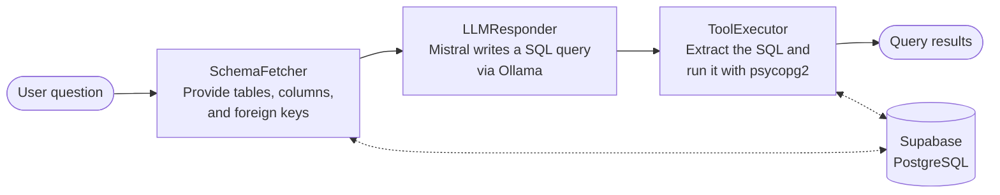

# Hermes: Natural Language to SQL with a Local LLM

Hermes lets you ask questions about a PostgreSQL database in plain English, without writing SQL. It reads the database schema, has a locally hosted LLM write the query, runs that query, and returns the results.

It runs against the [Chinook](https://github.com/lerocha/chinook-database) sample dataset (a digital music store's customers, invoices, tracks, and artists) hosted on Supabase. No paid model APIs are involved, because the model runs on your own machine through Ollama.

> **Status:** ongoing personal project. See [Current limitations](#current-limitations) and [Roadmap](#roadmap).

## How it works

Hermes is built as a [LangGraph](https://github.com/langchain-ai/langgraph) state machine with three steps. Each step reads from and writes to a shared `AgentState`.



1. **SchemaFetcher** supplies the schema of the `public` schema, read from `information_schema`: every table, its columns and data types, and its foreign key relationships. By default this is fetched once at startup and cached.
2. **LLMResponder** sends the schema and the user's question to the model, and asks for a SQL query in response.
3. **ToolExecutor** pulls the SQL out of the model's response, checks that it is a single read-only statement, runs it in a read-only transaction, and returns the rows or the error message. If the response doesn't look like SQL, it is returned as is.

## Key design decisions

- **Local LLM:** running the model through Ollama avoids paid APIs during development, and questions and schema details aren't sent to a third-party model provider. The model is a single setting, and the project has used both LLaMA 3 and Mistral.
- **Schema read at runtime:** giving the model the real table names, columns, and foreign keys reduces hallucinated identifiers and helps it write correct joins. It also means Hermes isn't tied to Chinook, and can point at another PostgreSQL database.
- **Reasoning separated from execution:** the model only produces text. It never holds a database connection, and all database access goes through application code.
- **Explicit graph over a free-running agent:** moving from a LangChain agent to LangGraph made the control flow predictable, and gives each step a clear place to add retries or validation later.
- **Tolerant SQL parsing:** local models don't always follow output instructions, so the parser handles bare SQL, Markdown code fences, and `Action Input:` formatted responses.

## Tech stack

| Area | Technology |
| --- | --- |
| Language | Python 3.12 |
| LLM | Mistral, served locally by Ollama |
| Orchestration | LangGraph, `langchain-ollama` |
| Database | PostgreSQL on Supabase, with the Chinook dataset |
| Database driver | psycopg2 |
| Configuration | python-dotenv |

## Getting started

### Prerequisites

- Python 3.12
- [Ollama](https://ollama.com/)
- A PostgreSQL database. A free [Supabase](https://supabase.com/) project works, loaded with the [Chinook PostgreSQL script](https://github.com/lerocha/chinook-database)

### 1. Clone the repository

```bash
git clone https://github.com/HamzaKhan760/Hermes.git
cd Hermes
```

### 2. Install the dependencies

```bash
python -m venv .venv

# Windows
.venv\Scripts\activate

# macOS / Linux
source .venv/bin/activate

pip install -r requirements.txt
```

### 3. Download the model

```bash
ollama pull mistral
```

Make sure Ollama is running before you start Hermes. To use a different model, change the `model` value in `agent_controller.py`.

### 4. Configure the database connection

Create a `.env` file in the project root:

```env
DB_HOST=your-database-host
DB_NAME=postgres
DB_USER=your-database-user
DB_PASSWORD=your-database-password
DB_PORT=5432
```

For Supabase, these values are in your project's connection settings.

> [!TIP]
> Hermes only runs single `SELECT` or `WITH` statements, inside a read-only transaction. For an extra layer of protection, connect with a read-only database role instead of an admin account.

### 5. Run Hermes

```bash
python main.py
```

Hermes handles one question per run.

## Usage

Type your question at the prompt:

```text
Ask about your data:
> Who are the top 5 best-selling artists?
Hermes says:
 1. <artist name> - <value>
 2. <artist name> - <value>
 ...
```

The output above shows the format, not real results. Other questions to try:

- Which country has the most customers?
- What are the 10 longest tracks?
- What was the total revenue per year?

## Project structure

```text
Hermes/
├── main.py               # Command-line entry point
├── agent_controller.py   # Agent graph, schema discovery, SQL parsing and execution
├── requirements.txt      # Pinned Python dependencies
└── .env                  # Database credentials (not committed)
```

## Current limitations

- **Raw results, not written answers:** Hermes returns query results directly. The model doesn't yet turn them into a natural language answer.
- **No retries:** each question gets one attempt at SQL. If the query fails, the database error is shown to the user and isn't sent back to the model.
- **One question per run:** there is no interactive session or conversation memory yet.

## Roadmap

- [x] Add database safety controls: query validation and read-only transactions
- [ ] Send SQL errors back to the model so it can correct its query
- [ ] Generate natural language answers and insights from query results
- [ ] Support multiple questions in one session
- [ ] Add automated tests
